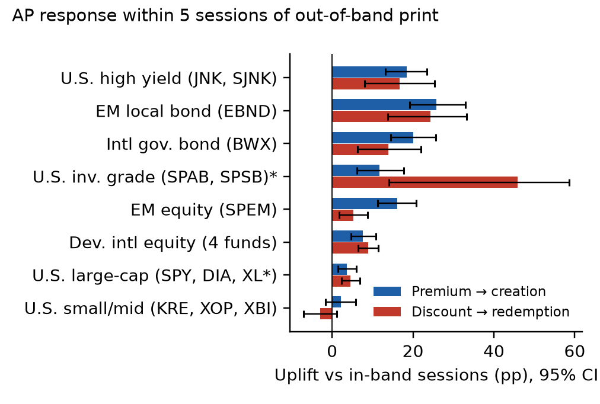
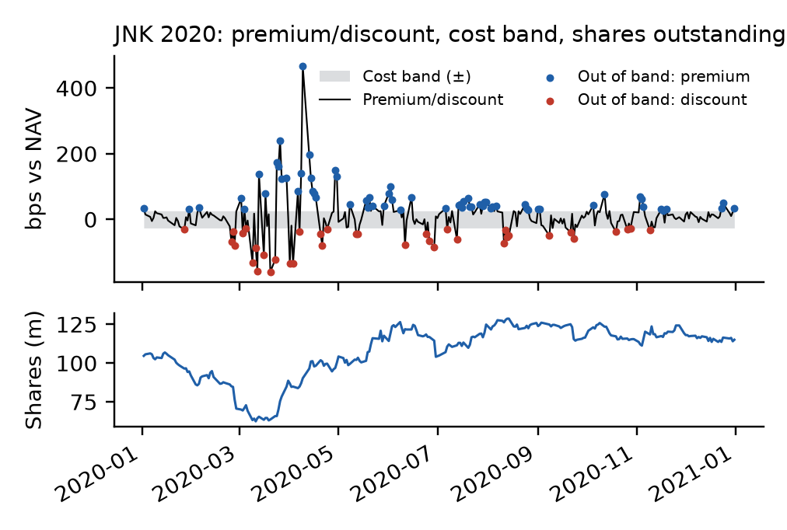
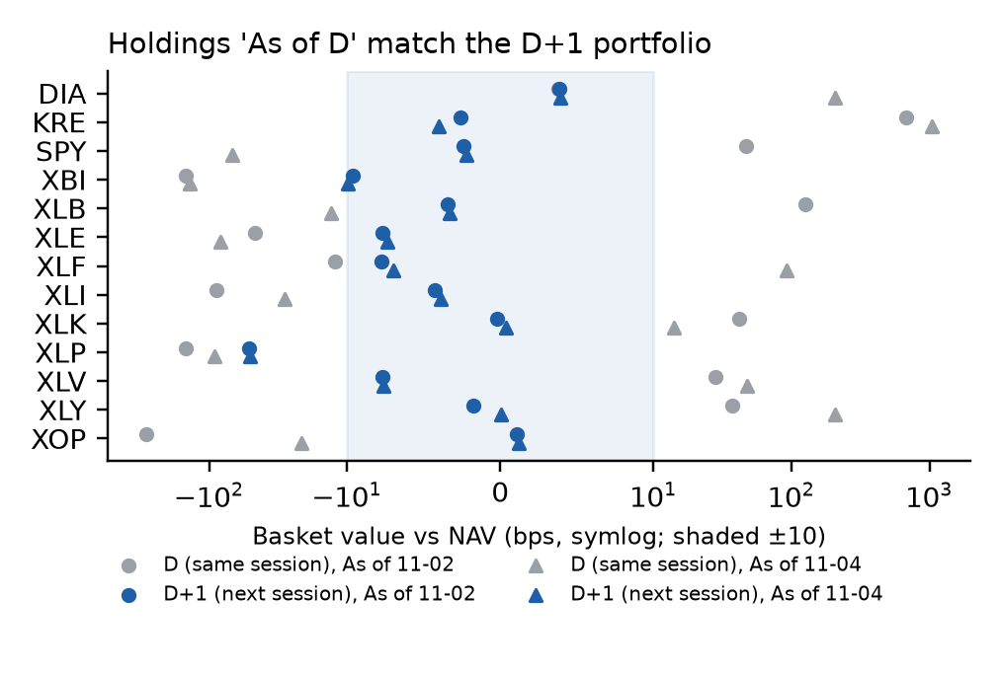
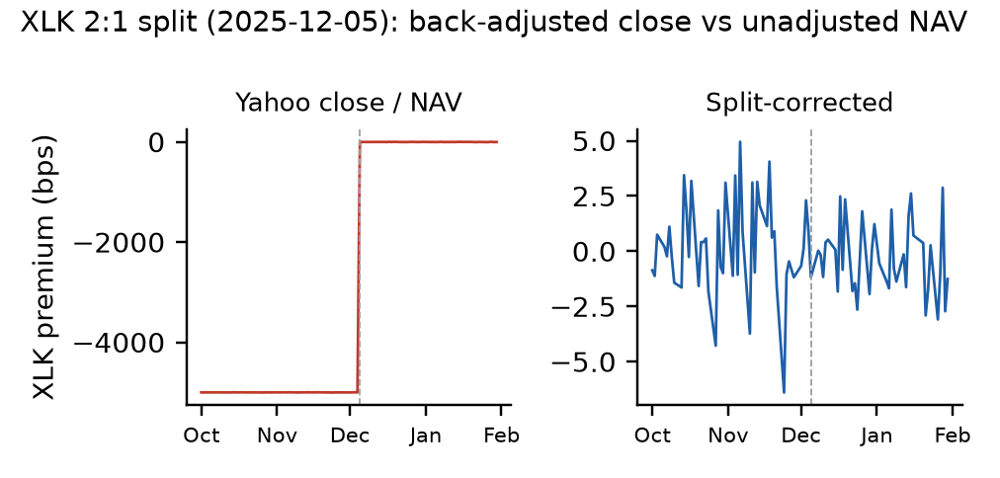

# ETF Arbitrage & Creation/Redemption Monitor

A daily monitor for 25 SPDR ETFs that compares market price with official NAV, values the creation basket from issuer holdings, models a cost-based arbitrage band, and tests whether authorized participants (APs) create or redeem when the price leaves the band (Jan 2018 to Nov 2026, 55,575 fund-sessions). It extends an earlier ETF crowding monitor (momentum/volatility signals and a Streamlit viewer, described below).

## Results

- **12 of 13** U.S. equity baskets within 10 bps of NAV on two holdings snapshots, after fixing a one-session holdings timing offset. Before the fix, gaps reached +1,035 bps.
- **+18 to +26 pp** more creations after out-of-band premiums in high-yield, EM local and international government bond funds, compared with in-band sessions.
- **~+4 pp** for U.S. large-cap equity funds. Their 3 bps band is breached often but rarely draws AP flow, so most of those breaches are close-vs-NAV noise.

[Read the ETF arbitrage and creation/redemption monitor case study](reports/etf-arbitrage-monitor-case-study.pdf).



Share of out-of-band sessions followed by net creation (premium) or redemption (discount) within 5 sessions, minus the in-band rate. Monthly block bootstrap. \*U.S. investment grade has only 43 discount events.



JNK went to a deep discount in March 2020, and shares outstanding fell about 40% as APs redeemed. It then moved to a sustained premium, and creations rebuilt the fund.



Basket value (shares held × component close + cash) vs NAV. Holdings labelled "As of D" match the D+1 share count and NAV. The large same-session gaps are timing, not mispricing.



Yahoo back-adjusts closes for splits, but the issuer's NAV history does not. Without the correction, every pre-split session shows a fake −5,000 bps discount.

**Data:** Raw provider data is not redistributed. The daily capture of SSGA NAV/holdings and Yahoo prices runs in a private deployment; all figures are derived aggregates.

**Status: Gate 5 — local read-only viewer.** This repository contains the
approved configuration, XNYS calendar helpers, an offline Yahoo chart parser,
canonical price validation and persistence, standalone adjusted-close signals,
point-in-time evaluation coverage, descriptive dependence diagnostics,
immutable verified bundles, and a local viewer. It does not calculate a
crowding score or make investment recommendations.

## Setup and checks

Install `uv`, then install the pinned Python and project environment:

### POSIX shell

```sh
uv python install 3.12
uv sync --locked
uv run ruff check .
uv run ruff format --check .
uv run mypy
uv run pytest -W error -q
```

### Windows PowerShell

```powershell
uv python install 3.12
uv sync --locked
uv run ruff check .
uv run ruff format --check .
uv run mypy
uv run pytest -W error -q
```

All data builders under `tests/fixtures/` generate fictional test inputs; they
are not captured market data or research results.

To make an authorized live Yahoo request, explicitly pass the authorization
flag. This command was not run as part of the offline test suite:

```text
uv run etf-monitor fetch-prices --end-exclusive YYYY-MM-DD \
  --authorize-live-request --data-root /path/to/local-data
```

`--data-root` is required. Canonical prices, raw responses, snapshots, and
acquisition records are written below that path. Without
`--authorize-live-request`, the CLI refuses before creating the live transport.

## Evaluate and preserve a run

All Gate 4 commands are offline; none constructs a provider transport. Supply
one aware instant so the target session is reproducible. The special value
`now` is captured once by the CLI.

```text
uv run etf-monitor evaluate \
  --prices /path/to/canonical-prices.parquet \
  --instant 2024-07-03T17:00:00Z \
  --out /path/to/evaluations
```

The command writes a uniquely named directory containing the canonical input,
coverage, Momentum, Volatility, two descriptive dependence tables, and a
manifest. Inputs after the target session are counted per ETF and excluded
from calculation. Bundle files are read-only; an existing run ID is never
overwritten.

Verify the complete bundle contract, byte and content hashes, target coverage,
and recomputed outputs before using a candidate:

```text
uv run etf-monitor verify /path/to/evaluations/<run-id>
```

Compare two verified bundles to report input-row revisions, changed fields,
per-ticker and signal changes, and target-session differences. This report is
descriptive; it does not infer a cause for any revision.

```text
uv run etf-monitor compare \
  /path/to/evaluations/<run-id-a> \
  /path/to/evaluations/<run-id-b>
```

An explicitly fictional, deterministic bundle is available for offline
workflow checks. It requires an explicit aware instant and is classified as
`FICTIONAL`; it is not observed market history.

```text
uv run etf-monitor demo-bundle \
  --instant 2020-03-31T22:00:00Z \
  --out /path/to/demo-evaluations
```

## Issuer NAV, premium/discount, and flow proxy (Gate 8)

Daily NAV and shares outstanding come from SSGA's public NAV-history
workbooks for the 25 SPDR funds configured in
`src/etf_monitor/config/issuer_nav_sources.yaml` (13 crowding-universe ETFs
and the separate 12-ETF arbitrage universe). Each download is an immutable
vintage holding the exact raw workbooks, validated rows, and a manifest.

```text
uv run etf-monitor fetch-issuer-nav --universe arbitrage \
  --data-root data --authorize-live-request
uv run etf-monitor fetch-prices --universe arbitrage \
  --end-exclusive 2026-11-04 --data-root data --authorize-live-request
uv run etf-monitor premium-flows --universe arbitrage \
  --prices data/arbitrage/processed/etf_prices_daily.parquet \
  --nav-vintage data/issuer_nav/arbitrage/nav-<batch-id> \
  --price-raw-dir data/arbitrage/raw/prices/<price-batch-id> \
  --out data/premium_flows/<name>
```

`premium-flows` is offline. It writes daily `premium_discount_bps`
(10,000 × (raw close × split factor / NAV − 1); SSGA does not restate NAV for
splits, so split events are read from the raw Yahoo payloads in
`--price-raw-dir`), the daily change in shares outstanding with
a **creation/redemption flow proxy** under both reporting alignments
(same-session and prior-session NAV), and a premium-to-share-change lead-lag
table. The proxy is an estimate from shares outstanding, not a reported fund
flow. See the Gate 8 section of `docs/decision-log.md`.

## Holdings basket value (Gate 9)

SSGA publishes each SPDR fund's latest daily holdings workbook. There is no
dated archive, so holdings history exists only from the first capture
onward; each capture is a new immutable vintage (raw workbooks plus a SHA-256
manifest; rows are re-derived from the raw bytes on every load).

```text
uv run etf-monitor fetch-holdings --universe core \
  --data-root data --authorize-live-request
uv run etf-monitor fetch-component-prices --universe core \
  --holdings-vintage data/holdings/core/holdings-<batch-id> \
  --start 2026-10-26 --end-exclusive 2026-11-05 \
  --data-root data --authorize-live-request
uv run etf-monitor basket-value --universe core \
  --holdings-vintage data/holdings/core/holdings-<batch-id> \
  --component-vintage data/component_prices/components-<batch-id> \
  --nav-vintage data/issuer_nav/core/nav-<batch-id> \
  --out data/basket_value/<name>
```

`basket-value` is offline. For U.S.-only equity funds it values the
published shares at component Yahoo closes (split-corrected to as-traded)
plus USD cash and money-market lines, divides by shares outstanding, and
reports `basket_vs_nav_bps` against official NAV under two alignments
(`same_session`, `next_session`). Use `next_session`: a snapshot labelled
`As of D` holds the portfolio for session D+1, so it matches D+1 shares
outstanding and NAV (see the Gate 9 timing note in `docs/decision-log.md`).
`same_session` gaps are creation/redemption timing, not dislocations. Index futures are valued at zero (variation margin is in cash);
rights, earn-outs, and non-USD cash are excluded and reported as
`unpriced_weight_pct`. Funds holding non-USD securities are not valued yet.
Fixed-income funds get only an `issuer_market_value` consistency check (the
issuer's own market values per share against NAV), which is not an
independent fair value. See `src/etf_monitor/arbitrage/basket.py`.

### Data capture

Raw or derived provider data is not distributed in this public repository.
Daily capture of SSGA NAV and holdings and Yahoo prices runs only in a private
deployment.

## Viewer

Start the read-only Streamlit viewer from the repository root and point it at
the directory containing bundle run directories:

```text
uv run streamlit run app/streamlit_app.py --server.address 127.0.0.1 \
  --server.port 8501 -- --bundles-root /path/to/evaluations
```

Instead of the command-line option, set `ETF_MONITOR_BUNDLES_ROOT` to that
directory before launching Streamlit. The viewer does not select a run by
default; choose a candidate explicitly in the sidebar. A selected run is
verified before any bundle contents are shown. Verification delegates to the
package's hash, schema, and full-recomputation checks; the viewer itself does
not perform additional financial calculations or make provider requests.
Successful immutable verified runs are cached for the lifetime of the viewer
process.

Flow and Concentration remain deferred and are explicitly shown as not
calculated. The viewer presents standalone Momentum and Volatility diagnostics
only; it does not produce a composite score or risk label.

### Hosted demo (Streamlit Community Cloud)

`deploy/bundles/` holds one committed bundle built by `etf-monitor demo-bundle`.
Its `data_classification` is `FICTIONAL`: synthetic prices, not market data.
No provider data is committed or republished.

To host the viewer over that bundle on Streamlit Community Cloud:

1. At <https://share.streamlit.io>, create an app from this repository with
   main file path `app/streamlit_app.py`. Community Cloud installs the
   environment from `uv.lock`.
2. Under **Advanced settings**, select Python 3.12 and add the secret
   `ETF_MONITOR_BUNDLES_ROOT = "deploy/bundles"`. Root-level secrets are
   exposed to the app as environment variables.
3. Apps from a private repository are private. Invite viewers by email from
   the app's **Share** menu.

`.gitattributes` disables line-ending conversion under `deploy/bundles/`, so
checkouts stay byte-identical to the hashed manifest. To regenerate the demo
bundle, run `etf-monitor demo-bundle --out deploy/bundles --instant <instant>`
and remove the old run directory.

## Signal methodology

Signals use a global XNYS session grid beginning at the first session on or
after 2018-01-01. Momentum is `float(np.log(A_t / A_(t-252)))`; its displayed
simple return is `100 * (A_t / A_(t-252) - 1)`. Only the exact endpoint rows and
adjusted closes determine eligibility; missing interior rows or adjusted
closes are counted, not skipped or filled.

Volatility uses exactly 22 consecutive session prices for 21 adjacent log
returns: `V_t = sqrt(252) * std(r, ddof=1)`, where
`r = log(A_i / A_(i-1))`; its displayed percentage is `100 * V_t`. Any absent
row or null adjusted close in that window makes the raw value unavailable;
constant log returns are valid zero volatility.

Both diagnostics are normalized independently per ETF using eligible prior
raw values from the trailing 756-session window, excluding the current session.
At least 252 references are required; percentile ties use exact float equality
and the midrank formula. Results are labelled as of the signal-session close;
the first prospective-use session is the next XNYS session. Missing data is
preserved and reported by status and counts. No filling, blending, clipping,
z-scores, composite, crowding score, or risk label is produced. The optional
`grid_start` override exists only for hand-checkable unit tests; evaluation
code must use the methodology start.

### Arbitrage band (Gate 10)

```
uv run etf-monitor arbitrage-band --prices <prices.parquet> \
  --premium-flows <premium-flows output dir> --universe arbitrage --out <dir>
```

Offline. Writes `arbitrage_band.parquet` (band, side, `persistent`,
`stale_nav` per session), `forward_share_response.parquet`, creation and
redemption frequencies by asset class and by fund, and `summary.json`. Cost
inputs and their EDGAR sources are in
`src/etf_monitor/config/arbitrage_costs.yaml`; basket and spread costs are
assumptions. See the Gate 10 entry in `docs/decision-log.md`.
