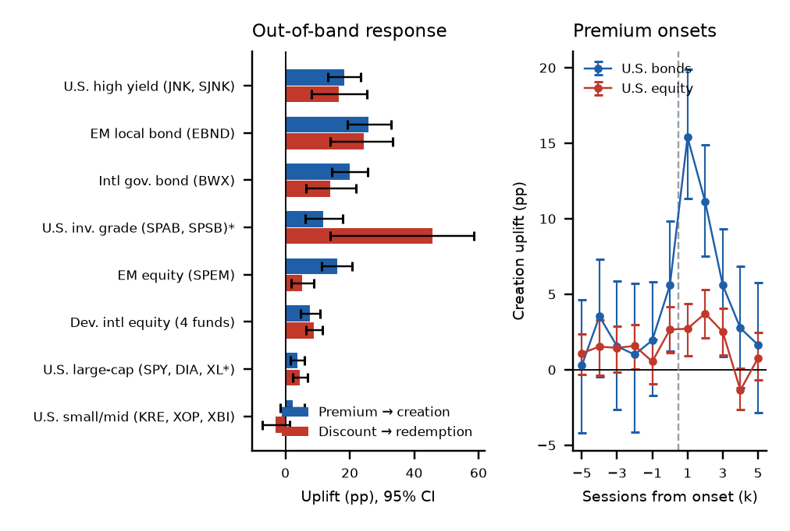
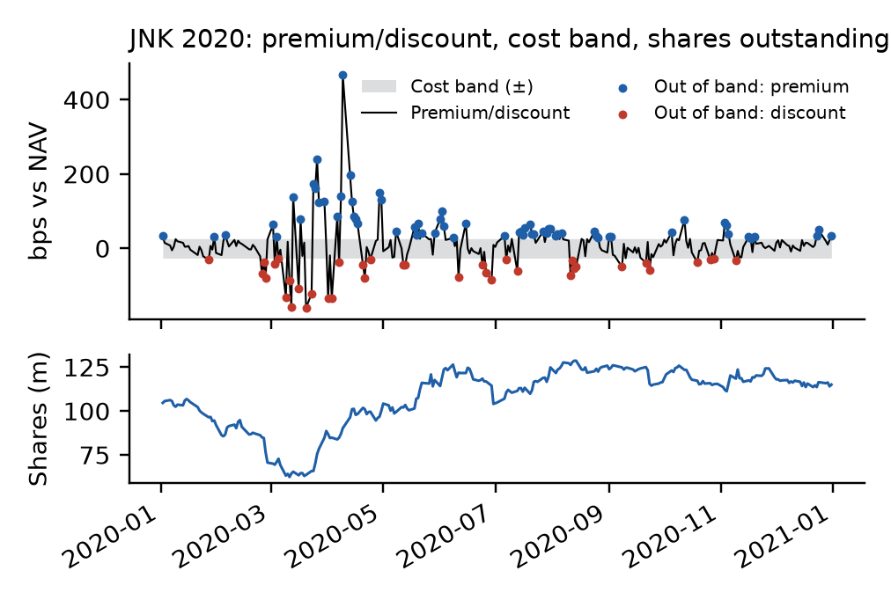
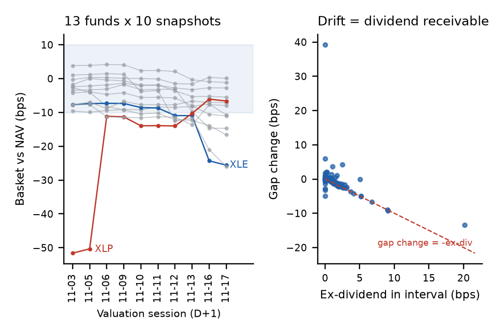
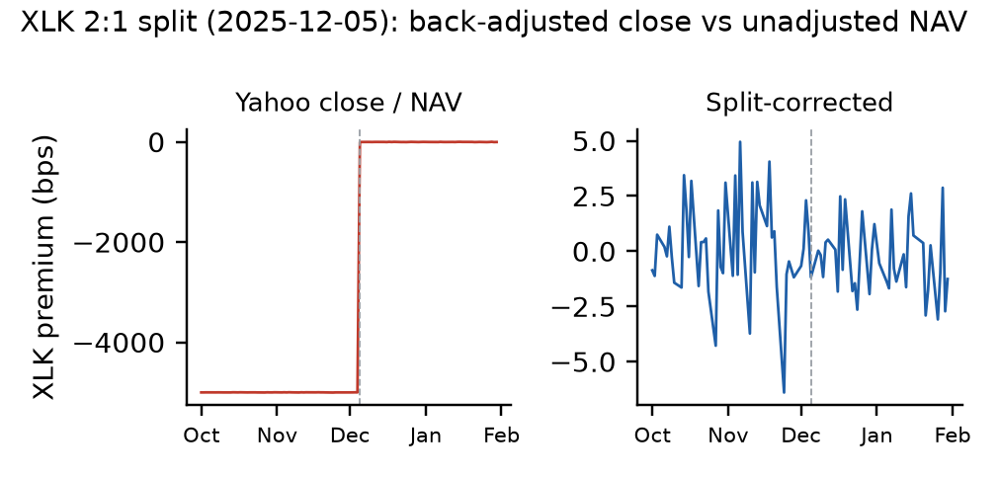

# ETF Arbitrage & Creation/Redemption Monitor

Do ETF authorized participants (APs) actually create and redeem shares when an
ETF's price drifts away from its NAV? This project builds a daily monitor for
25 SPDR ETFs to answer that from public data, and separates real dislocations
from the data and accounting artifacts that look like them.

**[Read the one-page case study (PDF)](reports/etf-arbitrage-monitor-case-study.pdf)** · **[Aggregate dashboard](https://blitzer04.github.io/etf-arbitrage-monitor/)**

| Item | Detail |
|---|---|
| Universe | 25 SPDR ETFs: U.S. equity, U.S. and international bond, international equity |
| Sample | Jan 2018 to Nov 2026, 55,575 fund-sessions |
| Data | SSGA NAV, shares outstanding and daily holdings; Yahoo prices and dividends; SEC N-CEN/SAI creation fees |
| Stack | Python 3.12, pandas, NumPy, PyArrow/Parquet, exchange-calendars, uv, Ruff, mypy, pytest |
| Tests | 399 automated tests, CI on Ubuntu and Windows |

## Key findings

| Finding | Result |
|---|---|
| Basket value vs NAV, after fixing a one-session holdings timing offset | **128 of 130** checks within 30 bps (13 U.S. equity funds, 10 daily snapshots); up to +1,035 bps before the fix |
| Remaining basket drift | Matches ex-dividend receivables to a median **0.2 bps** |
| AP response in high-yield, EM local and international government bond funds | **+18 to +26 pp** more likely to show net creations over the next 5 sessions after an out-of-band premium than after an in-band session |
| AP response in U.S. large-cap equity funds | **~+4 pp**: their ~3 bps band is breached often, but most breaches are close-vs-NAV noise |
| Event study, U.S. bond premium onsets | Creations jump one reported session after onset, with no pre-trend: post minus pre **+4.6 pp** (95% CI 2.1 to 6.9) |

These results are consistent with AP arbitrage on the premium side. They are
descriptive, not causal proof, and not a trading signal. See
[Limitations](#limitations).



*Left: share of out-of-band sessions followed by net creation (premium) or
redemption (discount) within 5 sessions, minus the in-band rate; monthly block
bootstrap. \*U.S. investment grade has only 43 discount events. Right: event
study around premium onsets.*



*JNK went to a deep discount in March 2020, and shares outstanding fell about
40% as APs redeemed. It then moved to a sustained premium, and creations
rebuilt the fund.*

## How it works

1. **Capture**: SSGA NAV, shares outstanding and daily holdings, Yahoo prices
   and dividends, stored as immutable vintages (raw files plus a SHA-256
   manifest, re-validated on every load).
2. **Align**: put every series on the XNYS session grid and correct splits,
   holdings dates and reporting lags.
3. **Value**: compute premium/discount and rebuild basket fair value from
   holdings.
4. **Band**: model the cost of arbitrage from SEC-filed creation fees, basket
   trading costs and ETF half-spreads.
5. **Test**: check whether shares outstanding respond when the premium leaves
   the band.


| Step | What it computes |
|---|---|
| Premium/discount | `split-corrected close / NAV - 1`, on the XNYS session grid |
| Flow proxy | `SO[t] / SO[t-1] - 1`; an estimate from shares outstanding, not a reported fund flow |
| Basket value | Shares held x component close + cash, per ETF share, compared with official NAV |
| Arbitrage band | `creation fee + basket trading cost + ETF half-spread`, in bps |
| AP response | Share of sessions with net creation (`SO[t+5] / SO[t] - 1 > 0`) after out-of-band premiums vs in-band sessions |

## Data pitfalls the monitor corrects

Most apparent dislocations turned out to be data artifacts. Each fix below is
covered by tests.

| Pitfall | Symptom | Fix |
|---|---|---|
| Holdings dated one session early | SSGA holdings labelled "As of D" are the D+1 portfolio; same-session gaps reached +1,035 bps | Compare D holdings with D+1 component closes and D+1 NAV (`next_session`) |
| Split adjustment | Yahoo back-adjusts closes for splits but issuer NAV does not; fake -5,000 bps discounts before XLK's split | Convert prices back to as-traded using split events from the raw payloads |
| Dividend receivables | Basket value drifts down on ex-dates because NAV includes receivables the holdings file omits | Reconcile gap changes against ex-dividend amounts (median residual 0.2 bps) |
| Stale international NAV | Foreign-close NAVs create mechanical premiums when U.S. markets move | Tag stale-NAV sessions and test them as a placebo |
| Late share reporting | SSGA reports shares one session after the trade date | Start response windows at t+1 |
| Large integers | Share counts above 2^53 lose precision as floats | Take integer differences before converting |



*Basket value (shares held x component close + cash) vs NAV. Holdings
labelled "As of D" match the D+1 share count and NAV. The large same-session
gaps are timing, not mispricing.*



*Yahoo back-adjusts closes for splits, but the issuer's NAV history does not.
Without the correction, every pre-split session shows a fake -5,000 bps
discount.*

## Identification checks

Run with `etf-monitor ap-identification` and `etf-monitor ap-6c11-did`.

| Check | Result |
|---|---|
| Event-study pre-trends | U.S. bond creations do not rise before a premium onset and jump one reported session after it |
| Fixed-effects panel | The premium effect survives fund and date fixed effects and lagged flows; U.S. equity shows no response |
| Dose-response and cost threshold | The response rises with premium size but does not jump at the modelled cost band |
| Stale-NAV placebo | International premiums predicted by U.S. market moves still draw some creations, less than the residual mispricing |
| Discount side | Confounded: redemptions are already elevated before discount onsets |
| Rule 6c-11 difference-in-differences | Failed its placebo test and parallel trends; reported as a limitation, not as evidence |

## Limitations

- The flow proxy is inferred from shares outstanding. It cannot separate
  arbitrage from other creation/redemption demand.
- The band depends on cost assumptions, mainly basket trading cost and ETF
  half-spread.
- Independent basket fair value covers U.S. equity funds only. International
  funds have stale NAVs.
- The basket model omits dividend receivables, so only gap changes are
  reconciled, not levels. The basket sample is 10 daily snapshots (Nov 2026).
- Five-session response windows overlap.

## Data policy

Raw or derived provider data is not redistributed. The daily capture of SSGA
NAV/holdings and Yahoo prices runs in a private deployment; all figures here
are derived aggregates. The dashboard under `site/` reads only
`site/data/public_aggregates.json`, a summary-statistics export with no
per-session, per-security, price, NAV or holdings values. The only committed bundle, under `deploy/bundles/`, is
synthetic and classified `FICTIONAL`.

## Repository layout

| Path | Contents |
|---|---|
| `src/etf_monitor/issuer_nav/` | SSGA NAV and shares-outstanding ingestion |
| `src/etf_monitor/holdings/` | SSGA daily holdings parsing and vintages |
| `src/etf_monitor/prices/`, `providers/` | Yahoo price ingestion and validation |
| `src/etf_monitor/arbitrage/` | Premium/discount, splits, dividends, basket value, band, response, identification, Rule 6c-11 |
| `src/etf_monitor/signals/`, `evaluation/`, `bundles/` | Earlier crowding monitor: signals, evaluation runs, verified bundles |
| `src/etf_monitor/config/` | Universes, issuer sources, creation costs with EDGAR sources |
| `app/` | Read-only Streamlit viewer |
| `reports/` | Case study PDF, figures, report builder |
| `docs/decision-log.md` | Methodology decisions, timing notes and results by gate |
| `tests/` | Offline tests built on fictional fixtures |

## Quick start

Install [`uv`](https://docs.astral.sh/uv/), then run the checks. The same
commands work in a POSIX shell and Windows PowerShell.

```sh
uv python install 3.12
uv sync --locked
uv run ruff check .
uv run ruff format --check .
uv run mypy
uv run pytest -W error -q
```

All data builders under `tests/fixtures/` generate fictional test inputs; they
are not captured market data or research results.

## Command reference

Commands that contact a provider require `--authorize-live-request`; without
it, the CLI refuses before creating the live transport. Analysis commands are
offline.

<details>
<summary><b>Issuer NAV, premium/discount and flow proxy</b></summary>

Daily NAV and shares outstanding come from SSGA's public NAV-history
workbooks for the 25 SPDR funds configured in
`src/etf_monitor/config/issuer_nav_sources.yaml` (13 crowding-universe ETFs
and the separate 12-ETF arbitrage universe). Each download is an immutable
vintage holding the exact raw workbooks, validated rows, and a manifest.

```text
uv run etf-monitor fetch-issuer-nav --universe arbitrage \
  --data-root data --authorize-live-request
uv run etf-monitor fetch-prices --universe arbitrage \
  --end-exclusive 2026-11-04 --data-root data --authorize-live-request
uv run etf-monitor premium-flows --universe arbitrage \
  --prices data/arbitrage/processed/etf_prices_daily.parquet \
  --nav-vintage data/issuer_nav/arbitrage/nav-<batch-id> \
  --price-raw-dir data/arbitrage/raw/prices/<price-batch-id> \
  --out data/premium_flows/<name>
```

`premium-flows` writes daily `premium_discount_bps`
(10,000 x (raw close x split factor / NAV - 1); SSGA does not restate NAV for
splits, so split events are read from the raw Yahoo payloads in
`--price-raw-dir`), the daily change in shares outstanding with a
**creation/redemption flow proxy** under both reporting alignments
(same-session and prior-session NAV), and a premium-to-share-change lead-lag
table. See the Gate 8 section of `docs/decision-log.md`.

</details>

<details>
<summary><b>Holdings basket value</b></summary>

SSGA publishes each SPDR fund's latest daily holdings workbook. There is no
dated archive, so holdings history exists only from the first capture
onward; each capture is a new immutable vintage (raw workbooks plus a SHA-256
manifest; rows are re-derived from the raw bytes on every load).

```text
uv run etf-monitor fetch-holdings --universe core \
  --data-root data --authorize-live-request
uv run etf-monitor fetch-component-prices --universe core \
  --holdings-vintage data/holdings/core/holdings-<batch-id> \
  --start 2026-10-26 --end-exclusive 2026-11-05 \
  --data-root data --authorize-live-request
uv run etf-monitor basket-value --universe core \
  --holdings-vintage data/holdings/core/holdings-<batch-id> \
  --component-vintage data/component_prices/components-<batch-id> \
  --nav-vintage data/issuer_nav/core/nav-<batch-id> \
  --out data/basket_value/<name>
uv run etf-monitor basket-history --universe core \
  --snapshot data/holdings/core/holdings-<snapshot-1> data/component_prices/components-<components-1> \
  --snapshot data/holdings/core/holdings-<snapshot-2> data/component_prices/components-<components-2> \
  --nav-vintage data/issuer_nav/core/nav-<batch-id> \
  --out data/basket_history/<name>
```

`basket-value` values the published shares of U.S.-only equity funds at
component Yahoo closes (split-corrected to as-traded) plus USD cash and
money-market lines, divides by shares outstanding, and reports
`basket_vs_nav_bps` against official NAV under two alignments
(`same_session`, `next_session`). Use `next_session`: a snapshot labelled
`As of D` holds the portfolio for session D+1 (see the Gate 9 timing note in
`docs/decision-log.md`). `same_session` gaps are creation/redemption timing,
not dislocations.

- Index futures are valued at zero (variation margin is in cash).
- Rights, earn-outs, and non-USD cash are excluded and reported as
  `unpriced_weight_pct`.
- Funds holding non-USD securities are not valued yet.
- Fixed-income funds get only an `issuer_market_value` consistency check (the
  issuer's own market values per share against NAV), which is not an
  independent fair value.

`basket-history` compares `next_session` rows across paired holdings and
component vintages, adding `gap_change_bps`, `ex_dividend_bps`,
`cash_change_bps`, `residual_bps`, and `dividend_coverage`. NAV includes
dividend receivables that the holdings file omits, so `next_session` gaps can
drift down on ex-dates and recover when dividend cash arrives. When the
component window does not cover an interval or a priced symbol failed,
`dividend_coverage` is false and ex-dividend/residual values are missing. It
writes `basket_history.csv` and a summary of gap thresholds and uncovered
dividend intervals.

</details>

<details>
<summary><b>Arbitrage band</b></summary>

```text
uv run etf-monitor arbitrage-band --prices <prices.parquet> \
  --premium-flows <premium-flows output dir> --universe arbitrage --out <dir>
```

Writes `arbitrage_band.parquet` (band, side, `persistent`, `stale_nav` per
session), `forward_share_response.parquet`, creation and redemption
frequencies by asset class and by fund, and `summary.json`. Cost inputs and
their EDGAR sources are in `src/etf_monitor/config/arbitrage_costs.yaml`;
basket and spread costs are assumptions. See the Gate 10 entry in
`docs/decision-log.md`.

</details>

<details>
<summary><b>AP identification checks and Rule 6c-11</b></summary>

`ap-identification` runs the event study, dose-response and local-RD checks,
stale-NAV placebo, and two-way fixed-effect panel regressions on the v2 band
and matching flow-proxy vintages. Its monthly block bootstrap uses seed
20261118; date fixed effects absorb market returns and volatility. The command
verifies that each flow directory matches the source recorded by its band run
and writes six CSV tables plus `summary.json`. Regression rows below the
specified fund/month/rank support thresholds remain in the output with
`status=insufficient_support`; RD bootstrap intervals are reported only when
at least 400 of 500 draws have full-rank designs.

```text
uv run etf-monitor ap-identification \
  --arbitrage-band data/arbitrage_band/arbitrage-20261105-v2 \
  --core-band data/arbitrage_band/core-20261105-v2 \
  --arbitrage-flows data/premium_flows/arbitrage-20261105 \
  --core-flows data/premium_flows/core-20261105 \
  --out /path/to/ap-identification
```

`ap-6c11-did` estimates whether the sensitivity of bond-fund creation and
redemption responses to signed cost-band multiples changed relative to core
U.S. equity funds after Rule 6c-11 took effect on 2019-12-23. It reports
fund-by-post and date fixed-effect estimates, dynamic half-year coefficients
relative to 2018H1, and the specified robustness checks.

```text
uv run etf-monitor ap-6c11-did \
  --arbitrage-band data/arbitrage_band/arbitrage-20261105-v2 \
  --core-band data/arbitrage_band/core-20261105-v2 \
  --arbitrage-flows data/premium_flows/arbitrage-20261105 \
  --core-flows data/premium_flows/core-20261105 \
  --out /path/to/ap-6c11-did
```

</details>

<details>
<summary><b>Earlier crowding monitor: prices, evaluation runs and bundles</b></summary>

This project extends an earlier ETF crowding monitor with standalone
momentum and volatility diagnostics. It does not calculate a crowding score or
make investment recommendations.

Fetch prices (live request):

```text
uv run etf-monitor fetch-prices --end-exclusive YYYY-MM-DD \
  --authorize-live-request --data-root /path/to/local-data
```

`--data-root` is required. Canonical prices, raw responses, snapshots, and
acquisition records are written below that path.

The evaluation commands are offline; none constructs a provider transport.
Supply one aware instant so the target session is reproducible. The special
value `now` is captured once by the CLI.

```text
uv run etf-monitor evaluate \
  --prices /path/to/canonical-prices.parquet \
  --instant 2024-07-03T17:00:00Z \
  --out /path/to/evaluations
```

The command writes a uniquely named directory containing the canonical input,
coverage, Momentum, Volatility, two descriptive dependence tables, and a
manifest. Inputs after the target session are counted per ETF and excluded
from calculation. Bundle files are read-only; an existing run ID is never
overwritten.

Verify the complete bundle contract, byte and content hashes, target coverage,
and recomputed outputs before using a candidate:

```text
uv run etf-monitor verify /path/to/evaluations/<run-id>
```

Compare two verified bundles to report input-row revisions, changed fields,
per-ticker and signal changes, and target-session differences. This report is
descriptive; it does not infer a cause for any revision.

```text
uv run etf-monitor compare \
  /path/to/evaluations/<run-id-a> \
  /path/to/evaluations/<run-id-b>
```

An explicitly fictional, deterministic bundle is available for offline
workflow checks. It requires an explicit aware instant and is classified as
`FICTIONAL`; it is not observed market history.

```text
uv run etf-monitor demo-bundle \
  --instant 2020-03-31T22:00:00Z \
  --out /path/to/demo-evaluations
```

**Signal methodology.** Signals use a global XNYS session grid beginning at
the first session on or after 2018-01-01. Momentum is
`float(np.log(A_t / A_(t-252)))`; its displayed simple return is
`100 * (A_t / A_(t-252) - 1)`. Only the exact endpoint rows and adjusted
closes determine eligibility; missing interior rows or adjusted closes are
counted, not skipped or filled.

Volatility uses exactly 22 consecutive session prices for 21 adjacent log
returns: `V_t = sqrt(252) * std(r, ddof=1)`, where
`r = log(A_i / A_(i-1))`; its displayed percentage is `100 * V_t`. Any absent
row or null adjusted close in that window makes the raw value unavailable;
constant log returns are valid zero volatility.

Both diagnostics are normalized independently per ETF using eligible prior
raw values from the trailing 756-session window, excluding the current session.
At least 252 references are required; percentile ties use exact float equality
and the midrank formula. Results are labelled as of the signal-session close;
the first prospective-use session is the next XNYS session. Missing data is
preserved and reported by status and counts. No filling, blending, clipping,
z-scores, composite, crowding score, or risk label is produced. The optional
`grid_start` override exists only for hand-checkable unit tests; evaluation
code must use the methodology start.

</details>

<details>
<summary><b>Streamlit viewer and hosted demo</b></summary>

Start the read-only viewer from the repository root and point it at the
directory containing bundle run directories:

```text
uv run streamlit run app/streamlit_app.py --server.address 127.0.0.1 \
  --server.port 8501 -- --bundles-root /path/to/evaluations
```

Instead of the command-line option, set `ETF_MONITOR_BUNDLES_ROOT` to that
directory before launching Streamlit. The viewer does not select a run by
default; choose a candidate explicitly in the sidebar. A selected run is
verified before any bundle contents are shown. Verification delegates to the
package's hash, schema, and full-recomputation checks; the viewer itself does
not perform additional financial calculations or make provider requests.
Successful immutable verified runs are cached for the lifetime of the viewer
process.

Flow and Concentration remain deferred and are explicitly shown as not
calculated. The viewer presents standalone Momentum and Volatility diagnostics
only; it does not produce a composite score or risk label.

`deploy/bundles/` holds one committed bundle built by `etf-monitor demo-bundle`.
Its `data_classification` is `FICTIONAL`: synthetic prices, not market data.
To host the viewer over that bundle on Streamlit Community Cloud:

1. At <https://share.streamlit.io>, create an app from this repository with
   main file path `app/streamlit_app.py`. Community Cloud installs the
   environment from `uv.lock`.
2. Under **Advanced settings**, select Python 3.12 and add the secret
   `ETF_MONITOR_BUNDLES_ROOT = "deploy/bundles"`. Root-level secrets are
   exposed to the app as environment variables.
3. Apps from a private repository are private. Invite viewers by email from
   the app's **Share** menu.

`.gitattributes` disables line-ending conversion under `deploy/bundles/`, so
checkouts stay byte-identical to the hashed manifest. To regenerate the demo
bundle, run `etf-monitor demo-bundle --out deploy/bundles --instant <instant>`
and remove the old run directory.

</details>
